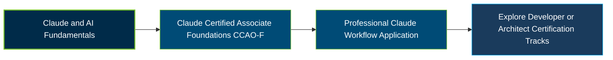

# Anthropic Claude Certified Associate - Foundations Certification Exam Guide

A dedicated study guide and professional AI reference repository for candidates preparing for the **Anthropic Claude Certified Associate - Foundations (CCAO-F) Certification Exam**.

---

## Exam Overview

The Claude Certified Associate - Foundations certification validates the ability to use Claude effectively and responsibly in professional workflows, evaluate AI-generated outputs, select appropriate features, and integrate Claude into everyday business tasks.

- **Exam Format**: Proctored examination with multiple-choice and multiple-response questions; online or Pearson VUE test center delivery.
- **Target Audience**: Consultants, sellers, delivery leads, operations professionals, marketers, project managers, educators, and other knowledge workers.
- **Prerequisites**: No prior certification or mandatory course is specified. Exam registration is limited to members of organizations in the Claude Partner Network.

---

## Core Exam Domains & Knowledge Areas

### 1. Output Evaluation and Validation

- Evaluate Claude responses for accuracy, completeness, relevance, and consistency.
- Verify facts, sources, citations, and generated information before relying on outputs.
- Identify hallucinations, limitations, and situations requiring human review.

### 2. Workflow Integration and Solution Design

- Identify opportunities to integrate Claude into professional tasks and business workflows.
- Design effective workflows using Claude features, tools, and integrations.
- Evaluate workflow suitability, efficiency, and opportunities for improvement.

### 3. Governance, Risk, and Responsible Use

- Apply responsible AI principles, acceptable-use policies, and organizational guidelines.
- Recognize privacy, confidentiality, security, bias, and compliance considerations.
- Maintain human oversight and accountability when using AI-generated outputs.

### 4. Prompting and Task Execution

- Create effective prompts using clear instructions, context, constraints, and examples.
- Break complex tasks into manageable steps and refine prompts iteratively.
- Apply prompting techniques to research, analysis, writing, and business tasks.

### 5. Product and Model Selection

- Understand Claude products, model capabilities, and available platform features.
- Select suitable models and tools based on task requirements and expected outcomes.
- Evaluate quality, efficiency, and cost considerations when choosing an approach.

### 6. Configuration and Knowledge Management

- Configure Claude Projects and instructions for specific professional workflows.
- Organize knowledge files and relevant context to improve task performance.
- Understand available workspace features, connectors, and knowledge-management options.

### 7. Troubleshooting and Optimization

- Identify causes of inaccurate, incomplete, or inconsistent Claude responses.
- Improve prompts, context, and workflow configurations to address performance issues.
- Recognize limitations and determine when alternative tools or human intervention are appropriate.

---

## Certification Path

---

## Recommended Practice & Study Resources

Combine Anthropic's official certification preparation courses with practical Claude usage and supplementary exam study materials.

- **CertsGate**: Explore [Anthropic CCAO-F certification preparation resources](https://certsgate.com/exams/anthropic/ccao-f) for supplementary study materials and practice questions.
- **Anthropic Academy**: Use [Claude 101 and AI Fluency learning resources](https://www.anthropic.com/learn) to develop practical skills in prompting, effective AI collaboration, and responsible Claude use.
